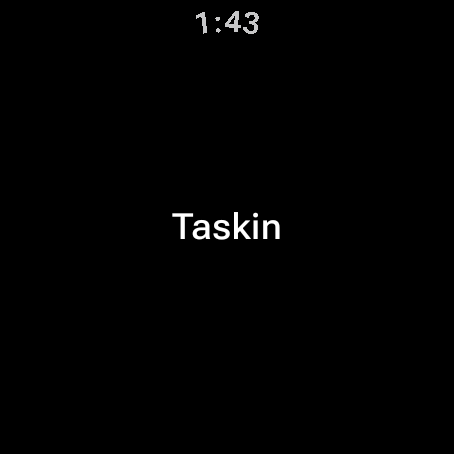

# 🧩 Task 175 — Esqueleto do app Wear OS em Kotlin e Compose, com teste rodando pelo pnpm

- Status: done
- Type: chore
- Assignee: sidartaveloso
- Group: taskin-no-pulso
- Priority: 6000
- Difficulty: 3

## Description
Criar packages/mascote-wear: projeto Gradle em Kotlin com Compose for Wear OS, standalone, que abre uma tela redonda vazia no emulador e tem um teste de unidade e um de UI rodando por pnpm --filter. E a base de todas as outras tasks do grupo.

## Tasks
<!-- [x] feito · [ ] em aberto · [ ] ... — adiado: <razão> para o que se decidiu não fazer -->
- [x] Teste primeiro: `core/.../TaskinWearTest.kt` (JUnit 5: o nome e "Taskin"; o teste enxerga a raiz do repositorio pela propriedade `taskin.repoRoot`) e `app/.../TelaInicialTest.kt` (Compose UI test com Robolectric, tela redonda `w227dp-h227dp-round-watch`: a tela inicial mostra "Taskin"). Os dois falharam antes do codigo (`Unresolved reference 'TaskinWear'`, manifesto ausente)
- [x] `packages/mascote-wear/` com Gradle 9.8.1 (wrapper versionado), AGP 9.4.1, Kotlin 2.4.21, JDK 21 (toolchain), `minSdk` 33 e `targetSdk` 36. **`compileSdk` ficou 37, e nao 36**: o Compose for Wear OS 1.7.1 e o BOM 2026.09 recusam compilar contra menos (`checkDebugAarMetadata`). A plataforma 37 foi instalada no `sidarta-desktop`
- [x] Dois modulos: `core` (Kotlin/JVM puro) e `app` (Android, `androidx.wear.compose:compose-material3` 1.7.1, BOM do Compose 2026.09.00). Versoes em `gradle/libs.versions.toml`
- [x] Manifesto de relogio: `uses-feature android.hardware.type.watch`, `com.google.android.wearable.standalone=true`, `MainActivity` com `AppScaffold`/`ScreenScaffold` mostrando "Taskin" centralizado (`TelaInicial.kt`)
- [x] `package.json` (`@opentask/taskin-mascote-wear`, `private`), validado pelo `pnpm lint:manifests`. Scripts: `wear:test`, `wear:test:core`, `wear:lint` (`:app:lintDebug`), `wear:build` (`:app:assembleDebug`)
- [x] Fora do `turbo` da raiz: os scripts tem o prefixo `wear:` para o `pnpm test`/`pnpm lint` da raiz nao exigirem JDK e Android SDK de quem so mexe no TypeScript. O pacote ganha job proprio no CI na task-185. Os comandos de verificacao das tasks 177 a 185 e 113 foram atualizados para esses nomes
- [x] `.gitignore` do pacote (`.gradle/`, `.kotlin/`, `build/`, `local.properties`, IDE)
- [x] Rodando no emulador `taskin_wear` (Wear OS 36, 454x454): `adb install` + `am start` com `Status: ok`
  - 
- [x] `README.md` do pacote: estrutura `core`/`app`, como desenvolver, por que o prefixo `wear:`

## Notes
Primeira task do grupo `taskin-no-pulso`. Contexto da decisao: a task-113 previa Capacitor, mas o Wear OS nao tem `WebView` (o emulador Wear OS 36 nao tem nem o servico `webviewupdate`, e o Android nao o liga em relogio), entao o app do relogio e nativo, em Kotlin com Compose for Wear OS.

A separacao `core`/`app` e a decisao que mais pesa: tudo que e regra fica em Kotlin/JVM puro e se testa em milissegundos, sem emulador e sem Android SDK; o `app` so liga sensores, audio e desenho a essas regras.

### Contexto da rodada
- Ler: este arquivo; `packages/mascote/package.json` (para o formato de pacote-aplicacao do repositorio); `pnpm-workspace.yaml`; `turbo.json`.
- Nao ler: `packages/design-vue`, `packages/ui-sense` — nao entram nesta task.

### Verificacao
```bash
pnpm --filter @opentask/taskin-mascote-wear wear:test
pnpm --filter @opentask/taskin-mascote-wear wear:lint
pnpm --filter @opentask/taskin-mascote-wear wear:build
```

### Onde executar
`sidarta-desktop` (Tailscale): e a maquina com JDK 21 (asdf, Temurin), Android SDK em `~/Android/Sdk` (plataforma 36, build-tools 36, emulador e a imagem Wear OS 36 no AVD `taskin_wear`, redondo 454x454) e Docker nativo. O Mac nao tem Android SDK. Abrir um shell interativo (o `.bashrc` so exporta `ANDROID_HOME` e o PATH do SDK em shell interativo).

Fechar a task so com o checklist marcado e, ao lado de cada item, o que o comprova (nome do teste, comando, arquivo).

### Resultado

```
./gradlew test          → TaskinWearTest: 2 testes, 0 falhas · TelaInicialTest: 1 teste, 0 falhas
./gradlew :app:lintDebug → 0 erros, 5 avisos (IconLauncherShape: o icone provisorio preenche o quadrado)
./gradlew :app:assembleDebug → app-debug.apk, 28 MB
pnpm format             → sem correcoes
pnpm lint:manifests     → @opentask/taskin-mascote-wear OK
```

O icone do launcher e **provisorio**: veio de `packages/mascote/public/icone-512.png`, que e gerado do `taskin.svg` — o mascote V1. O relogio usa o mascote novo; a troca do icone entrou na task-179.

Dois tropecos do caminho, para quem vier depois: o Robolectric precisa de `--add-exports java.base/jdk.internal.access=ALL-UNNAMED` no JDK 21 (esta no `app/build.gradle.kts`); e o emulador Wear OS novo abre no assistente de configuracao, que cobre o app — `adb shell settings put global device_provisioned 1` e `settings put secure user_setup_complete 1` o tiram da frente.

Os testes rodaram no `sidarta-desktop`, com o pacote sincronizado do Mac por `rsync`.
