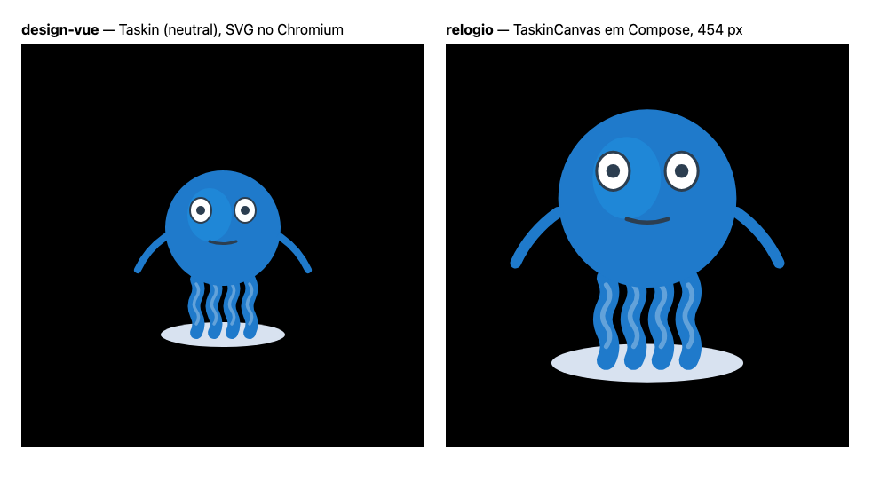
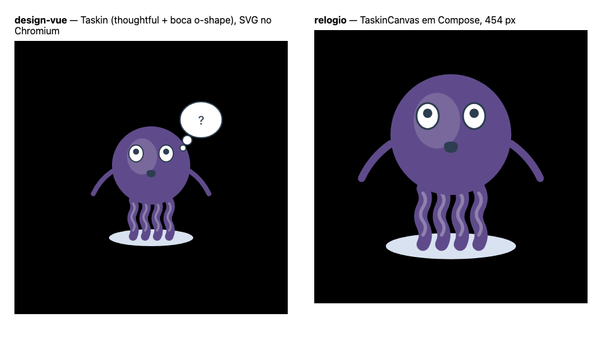
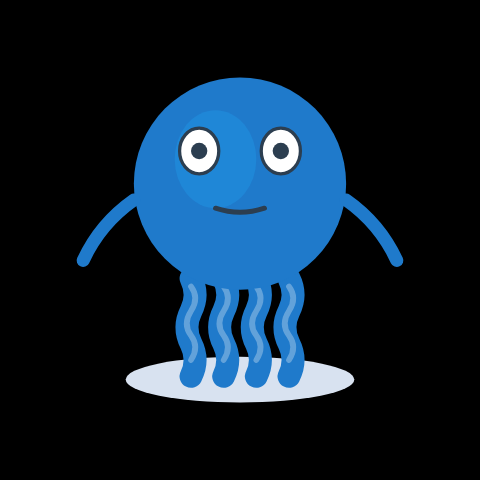
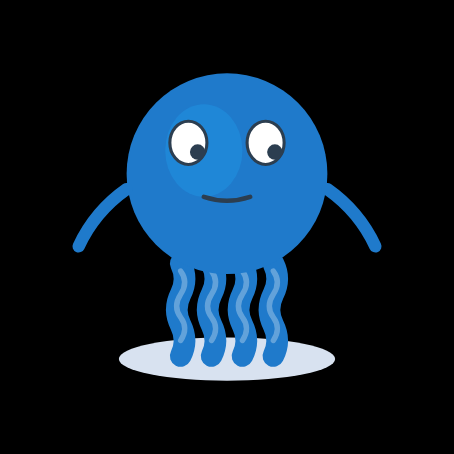
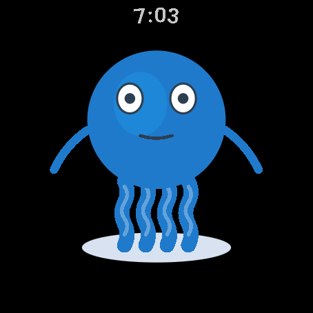
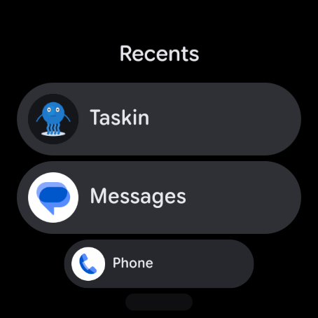

# 🧩 Task 179 — O Taskin desenhado em Compose na tela redonda, com os mesmos tracos do SVG

- Status: done
- Type: feat
- Assignee: sidartaveloso
- Group: taskin-no-pulso
- Priority: 6400
- Difficulty: 4

## Description
Desenhar o mascote em Compose Canvas reaproveitando os paths do SVG do design-vue, sem redesenhar a mao, com os humores que o shhh usa, cabendo inteiro em telas redondas de 432 a 480 px, e com teste de captura de tela como evidencia.

## Tasks
<!-- [x] feito · [ ] em aberto · [ ] ... — adiado: <razão> para o que se decidiu não fazer -->
- [x] **O mascote e o novo**, o `Taskin` de `organisms/taskin/Taskin.ts`, montado pelos atomos — e nao o `TaskinV1`. O gerador renderiza o proprio `Taskin` (SSR do Vue pelo Vite do design-vue); nada do `taskin.svg` entra no relogio
- [x] Desenho gerado, e nao copiado: `pnpm mascote-wear:desenho` (`dev/scripts/gerar-desenho-do-mascote-no-relogio.ts`) renderiza os quadros `NEUTRO` (`neutral`) e `SHHH` (`thoughtful` + boca `o-shape`, os do `TaskinWithShhh`) e escreve `app/src/main/kotlin/.../desenho/DesenhoGerado.kt`: 18 formas por quadro, com a transformacao dos grupos acumulada, as cores herdadas e as pupilas marcadas. `--check` falha se o arquivo estiver velho em relacao ao componente. O conversor (`dev/scripts/desenho-do-mascote-no-relogio/converter.ts`) tem 15 testes, inclusive os que derrubam a geracao diante de cor, transform ou elemento que ele nao entende — foi assim que apareceram o `rgba(...)` do brilho do corpo e o `<text>` do balao
- [x] Teste primeiro: `TaskinCanvasCapturaTest` (Roborazzi 1.76 sobre Robolectric 4.17, graficos nativos), `FormasComOlharTest` e `EncaixeTest` escritos antes do desenho, vermelhos por compilacao. As capturas ficam em `app/src/test/snapshots/` e o `verifyRoborazziDebug` compara contra elas
- [x] `TaskinCanvas` em Compose: `PathParser` para os `d`, `addOval` para elipses e circulos, a matriz de cada forma aplicada ao caminho e o traco escalado por ela. Encaixe pela **area que o mascote ocupa** (uniao dos dois quadros), e nao pelo `viewBox` 320x260, que tem folga para baloes e deixava o mascote pequeno; `encaixarNoCirculo` (no `core`) poe a diagonal dessa area no diametro da tela, menos 4%
- [x] Os humores do shhh: neutro e shhh. O balao de pensamento fica de fora do desenho gerado (`ignorarGrupos: ['effect-thought-bubble']`): ele leva a frase que a pessoa configura, e o relogio vai desenha-lo com texto nativo na task-182. Os outros 15 humores ficam fora
- [x] Pupilas como estado separado: `Olhar(x, y)` em -1..1 no `core`, e `formasComOlhar` desloca so as formas marcadas como pupila, no alcance `ALCANCE_DA_PUPILA = 6` lido do `trackingBounds` do `TaskinEyes`. E a costura que a task-180 usa
- [x] Icone do launcher trocado: sai da captura `neutro-480` do proprio Compose, recortado em circulo, nas cinco densidades. O provisorio vinha do `taskin.svg` (o V1). Com isso o `lintDebug` ficou sem nenhum aviso
- [x] Tela inicial mostra o mascote (`TelaInicialTest` agora procura a descricao "Taskin" para o leitor de tela; falhou antes da troca)
- [x] Evidencia visual, comparando com o componente do design-vue renderizado no Chromium:
  - 
  - 
  -   
  -  

## Notes
Depende da task-175. O desenho e o ponto onde a versao nativa mais corre risco de virar "outro mascote": por isso os tracos vem do SVG por geracao, e a comparacao lado a lado com o Storybook e a evidencia exigida.

O Galaxy Watch6 tem tela redonda de 432 px (40 mm) e 480 px (44 mm); o emulador `taskin_wear` e 454 px.

### Contexto da rodada
- Ler: `packages/design-vue/src/components/organisms/taskin/Taskin.ts` (so o trecho do `viewBox` e a montagem dos atomos, por volta da linha 1345, e `TASKIN_MOODS` em `Taskin.moods.ts`); os `.vue` dos atomos citados, so os `<path>`/`<ellipse>`/`<circle>` e as cores.
- Nao ler: `TaskinV1.ts`, `taskin.svg`, stories, specs do design-vue, actions/controller do Taskin.

### Verificacao
```bash
pnpm --filter @opentask/taskin-mascote-wear wear:test
pnpm --filter @opentask/taskin-mascote-wear wear:lint
pnpm --filter @opentask/taskin-mascote-wear wear:build
```

### Onde executar
`sidarta-desktop` (Tailscale): e a maquina com JDK 21 (asdf, Temurin), Android SDK em `~/Android/Sdk` (plataforma 36, build-tools 36, emulador e a imagem Wear OS 36 no AVD `taskin_wear`, redondo 454x454) e Docker nativo. O Mac nao tem Android SDK. Abrir um shell interativo (o `.bashrc` so exporta `ANDROID_HOME` e o PATH do SDK em shell interativo).

Fechar a task so com o checklist marcado e, ao lado de cada item, o que o comprova (nome do teste, comando, arquivo).

### Resultado

```
./gradlew test → core 63 · app 11 (TaskinCanvasCapturaTest 5, FormasComOlharTest 3, ArmazenamentoDoRelogioTest 2, TelaInicialTest 1) — 0 falhas
./gradlew :app:verifyRoborazziDebug → capturas iguais as gravadas
./gradlew :app:lintDebug → No issues found
pnpm test:dev-scripts → 15 arquivos, 120 testes
pnpm mascote-wear:desenho --check → em dia com o Taskin do design-vue
```

O icone foi recortado por um script avulso do Playwright a partir de `app/src/test/snapshots/neutro-480.png`; nao ficou um gerador versionado. Se o mascote mudar, o caminho e regravar as capturas e recortar de novo — anotado para a task-185, que cuida do build.
