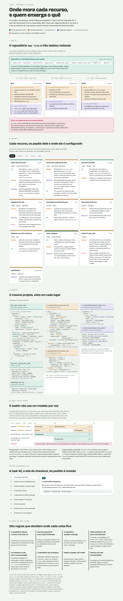

# 🧩 Task 234 — O mapa dos recursos como pagina no repositorio

- Status: done
- Type: docs
- Assignee: sidartaveloso
- Group: situacao-lote-6
- Priority: 9614
- Difficulty: 1

## Description
A página que mostra onde mora cada recurso e cada configuração do taskin, versionada ao lado do RDT: o que viaja pelo Git, o que fica na camada de cada pessoa, o que fica no estado de cada máquina e o que as máquinas de uma pessoa contam umas às outras. Os exemplos são um repositório de exemplo com três pessoas (duas programadoras e uma designer), contas de IA do time e pessoais, um servidor de build, um notebook, um smartphone, um smartwatch, um desktop com GPU e a smart TV de quem revisa. A página também mostra como um plano distribui tasks entre vários modelos, contas e máquinas ao mesmo tempo, e uma task de exemplo atravessando tudo.

## Tasks
<!-- [x] feito · [ ] em aberto · [ ] ... — adiado: <razão> para o que se decidiu não fazer -->
- [x] A página em `docs/RDT/consciencia-situacional-mapa.html`, autocontida (abre direto no navegador), clara e escura, sem rolagem lateral no celular
  - Prova: `TASKS/assets/task-234/mapa-claro.png` (1280 px) e `TASKS/assets/task-234/mapa-celular.png` (390 px), capturadas com o Chromium do Playwright; nas três capturas (clara, escura, celular) `scrollWidth` não passa da largura da janela.
- [x] O RDT aponta para a página, e a página aponta para as tasks de cada coisa que ainda falta
  - Prova: a seção "O mapa" no início do RDT; a nota final da página cita as tasks 227, 228, 229, 230 e 235 a 240.
- [x] Nada privado: nenhum nome de máquina, rede, hardware ou projeto real; as pessoas e o repositório são os de exemplo dos testes
  - Prova: busca por caminhos pessoais e nomes de máquina na página, vazia.

## Notes
A mesma página foi publicada como artefato para leitura fora do repositório. Quando o desenho mudar (por exemplo, depois das tasks 228 e 239), atualizar a página junto.

### Onde executar
Interativo: é documentação com revisão visual.

Fechar a task só com o checklist marcado e, ao lado de cada item, o que o comprova (nome do teste, comando, arquivo).
